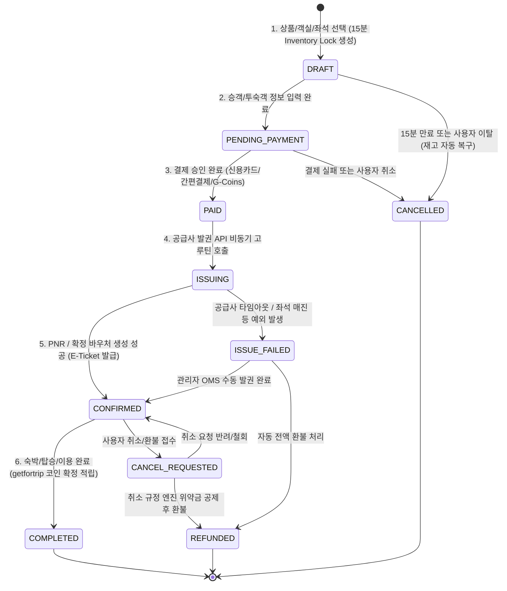

# ✈️ [Project: getfortrip Global OTA Platform] Master Architecture & IA Specification

> **프로젝트 공식 명칭**: getfortrip Global OTA Platform  
> **공식 서비스명**: getfortrip  
> **예정 도메인**: getfortrip.com  
> **아키텍처 버전**: v1.1.0 (Production Master)  
> **엔지니어링 원칙**: Zero-Mock (100% 실데이터 DB 연동), Domain-Driven Modularization, High-Concurrency Parallel Search, Strict Brand Governance

---

## 🛠️ 1. 확정 기술 스택 (Tech Stack Specification)

| 계층 | 기술 스택 | 버전 / 도구 | 선정 근거 및 핵심 역할 |
| :--- | :--- | :--- | :--- |
| **User Web Frontend** | TypeScript, Vue 3, Nuxt 3, Tailwind CSS, Pinia | Nuxt 4/3.13+, Vue 3.5+, Tailwind v3.4+ | getfortrip 사용자 웹, 다통화/다국어 실시간 반응형 UI, URL 동기화 검색 필터, Cloudflare Workers 배포 |
| **Admin Console** | TypeScript, Vue 3, Vite, Tailwind CSS, Pinia | Vite 5+, Vue 3.5+ | 고속 SPA 로딩, getfortrip 8대 OMS/CMS/정산/카탈로그 관제 대시보드 |
| **Mobile App (대비)** | Dart, Flutter | Flutter 3.24+ | 크로스플랫폼(iOS/Android) 단일 코드베이스 확장성 |
| **Backend & API Server** | Go (Golang) | Go 1.23+ (1.27 호환) | getfortrip 코어 엔진 (`getfortrip/backend`), 멀티 공급사 병렬 조회, 고성능 가격/세금 계산, 무오차 상태 머신 |
| **API 아키텍처** | RESTful API, SSE (Server-Sent Events) | OpenAPI 3.1 규격 | 표준화된 엔드포인트 + 좌석/가격 실시간 스트리밍 알림 |
| **Database & Cache** | PostgreSQL 16 (PostGIS, JSONB), Redis 7 | PG 16, Redis 7 (or Pure Go SQL Engine Fallback) | 지리 정보(위경도), 정규화된 7대 도메인 카탈로그, 15분 재고 홀딩 락(Lock) |

---

## 🗺️ 2. 사용자(User) & 관리자(Admin) 전체 IA (Information Architecture)

### [A] 사용자(User) 전 페이지 IA 트리

```
User Web Frontend (/)
│
├── 1. 글로벌 메인 홈 (/)
│   ├── GNB (getfortrip 로고, 통합 검색창, 통화 전환기, 고객센터, G-Coins/등급 배지, 내 예약, 프로필)
│   ├── 7대 도메인 통합 탭 검색 위젯 (숙소 / 항공권 / 기차표 / 렌터카 / 공항픽업 / 투어·티켓 / 항공+호텔)
│   ├── 메가세일 / 타임딜 프로모션 배너 캐러셀
│   ├── 인기 추천 도시 카드 (서울, 도쿄, 오사카, 방콕, 다낭, 파리 등)
│   ├── getfortrip Best 랭킹 (호텔 TOP 10, 관광명소 TOP 10)
│   ├── 여행 모먼트 (getfortrip Moments 포토 여행기) 프리뷰
│   └── 글로벌 푸터 (getfortrip 소개, 파트너십, 이용약관, 결제 보안 인증 IATA/PCI-DSS)
│
├── 2. 숙소 도메인 (/hotels/*)
│   ├── /hotels (숙소 검색 전용 홈)
│   ├── /hotels/list (숙소 검색 결과 리스트: 12개 필터, 지도 분할 Map View)
│   ├── /hotels/:id (숙소 상세: 고해상도 갤러리, AI 리뷰 요약, 객실 타입/요금/취소규정 비교 매트릭스)
│   └── /hotels/booking (체크아웃: 투숙객 정보, 특별 요청사항, 쿠폰/G-Coins 적용, 바우처 즉시 발급)
│
├── 3. 항공권 도메인 (/flights/*)
│   ├── /flights (편도/왕복/다구간 검색 홈)
│   ├── /flights/search (전후 7일 최저가 바, 직항/경유/항공사/시간대/수하물 필터)
│   └── /flights/booking (승객 여권 정보 입력, 수하물/좌석 지정 부가서비스, PNR E-Ticket 발권)
│
├── 4. 기차표 도메인 (/trains/*)
│   ├── /trains (한국 KTX, 일본 신칸센, 유럽 유로스타 스케줄 조회)
│   ├── /trains/search (출발/도착역 시간표, 일반실/특실/1등석 선택)
│   └── /trains/booking (승객 매핑 및 실시간 QR 티켓 발권)
│
├── 5. 렌터카 & 공항픽업 (/cars/*, /transfers/*)
│   ├── /cars, /cars/search (인수/반납 지점, 자차보험 옵션 비교, 차종/변속기 필터)
│   └── /transfers, /transfers/search (공항 픽업/샌딩, 항공편 연동 추적, 차량 정원/수하물 선택)
│
├── 6. 투어 & 티켓 / 액티비티 / eSIM (/things-to-do/*)
│   ├── /things-to-do (도시별 명소 입장권, 테마파크, 일일투어, 교통패스, 5G eSIM)
│   ├── /things-to-do/list (카테고리별 상품 필터)
│   └── /things-to-do/:id (날짜/권종 옵션 선택 및 즉시 E-Voucher 예약)
│
├── 7. 항공+호텔 다이내믹 패키지 (/packages/*)
│   ├── /packages (패키지 홈)
│   └── /packages/builder (왕복 항공편 + 호텔 동시 선택, 결합 할인 자동 적용 일괄 예약)
│
├── 8. 여행 가이드 & getfortrip Best & 여행 모먼트 (/guide/*, /trip-best, /moments/*)
│   ├── /guide/:city (도시별 여행 백과사전, 필수 코스)
│   ├── /trip-best (getfortrip Best 호텔/맛집/명소 연간 랭킹)
│   ├── /moments (getfortrip Moments 여행자 포토 & 숏폼 커뮤니티 피드)
│   ├── /moments/:id (모먼트 상세 및 본문 내 숙소/투어 상품 원클릭 예약 링크)
│   └── /moments/write (모먼트 작성, 사진 업로드, 상품 태그, 리워드 적립)
│
├── 9. 프로모션 & 리워드 멤버십 (/deals, /rewards)
│   ├── /deals (글로벌 프로모션 코드 센터, 타임딜 쿠폰 다운로드)
│   └── /rewards (회원 5단계 등급 Silver~Diamond+ 진행률, getfortrip Coins 적립/사용 내역 원장)
│
└── 10. 마이페이지 & 고객센터 (/my/*, /help)
    ├── /my/bookings (전 도메인 통합 예약 내역, 셀프 취소/환불 신청)
    ├── /my/bookings/:id (예약 상세, 모바일 바우처/E-Ticket/영수증 인쇄)
    ├── /my/travelers (자주 쓰는 여행자 여권 주소록 CRUD)
    ├── /my/wishlist (찜한 호텔/항공편 목록)
    └── /help (24/7 실시간 FAQ, 1:1 고객센터 상담 문의)
```

---

### [B] 관리자(Admin) 전 모듈 IA 트리 (`/admin/*`)

```
Admin Console (/admin)
│
├── 1. 통합 대시보드 (/admin/dashboard)
│   ├── 실시간 GMV (총 거래액), 일간/주간 예약 건수, 도메인별 매출 점유율 파이 차트
│   └── 공급사 API 연동 상태, 평균 응답 지연 시간(Latency), 실패율 모니터링
│
├── 2. 상품 & 인벤토리 카탈로그 관리 (/admin/catalog/*)
│   ├── /admin/catalog/hotels (숙소 및 객실 타입, 기본 요금, 재고 제어)
│   ├── /admin/catalog/flights (항공 스케줄, 운임 등급, 좌석 할당)
│   ├── /admin/catalog/trains (열차 노선, 시간표, 좌석 요금)
│   ├── /admin/catalog/cars (렌터카 차종, 보험 옵션, 제휴사)
│   └── /admin/catalog/activities (투어, 티켓, eSIM 재고 및 가격)
│
├── 3. 가격·환율·수수료 엔진 (/admin/pricing)
│   ├── 실시간 다통화 환율(FX) 테이블 수동/자동 동기화
│   ├── 도메인별 마크업(Markup %), 발권 수수료, 서비스 피 설정
│   └── 패키지 결합 할인율 규칙 관리
│
├── 4. 예약·발권·환불 OMS (/admin/bookings, /admin/refunds)
│   ├── /admin/bookings (전체 예약 검색, 상태 필터링, 상세 보기)
│   ├── /admin/bookings/:id (상태 강제 전이, 수동 PNR/바우처 번호 기입)
│   └── /admin/refunds (취소 위약금 자동 계산 검증, 환불 승인/반려)
│
├── 5. 마케팅·쿠폰·리워드 관리 (/admin/promotions, /admin/rewards)
│   ├── /admin/promotions (쿠폰 코드 생성, 정률/정액 할인, 적용 조건)
│   └── /admin/rewards (회원 등급별 getfortrip 코인 적립 배율, 수동 코인 지급/차감)
│
├── 6. 커뮤니티 & 리뷰 CMS (/admin/reviews, /admin/moments)
│   ├── /admin/reviews (사용자 리뷰 검수, 부적절한 게시글 블라인드)
│   └── /admin/moments (getfortrip 모먼트 신고 처리, 메인 피처드 선정)
│
├── 7. 고객센터 & 공지 관리 (/admin/support, /admin/notices)
│   ├── /admin/support (1:1 고객 문의 티켓 할당 및 답변 작성)
│   └── /admin/notices (천재지변/결항 긴급 팝업 및 공지사항 배너 등록)
│
└── 8. 정산 & 감사 로그 (/admin/settlements, /admin/audit-logs)
    ├── /admin/settlements (공급사별 정산 대사, 커미션 리포트 내보내기)
    └── /admin/audit-logs (관리자 계정별 전체 작업 내역, IP, 이전/이후 JSON 비교)
```

---

## 🔄 3. 핵심 비즈니스 Flow 및 상태 머신 (State Machine)

### 3.1 예약 라이프사이클 상태 머신 (State Diagram)



---

## 💰 4. 정밀 가격 및 환율 엔진 계산 공식 (Pricing Specification)

1. **원화 기준 총액 계산**:
   $$\text{GrossAmountKRW} = \text{BasePrice} + \text{Tax}(10\%) + \text{ServiceFee}(3\%)$$
2. **할인 적용**:
   $$\text{FinalAmountKRW} = \max(0, \text{GrossAmountKRW} - \text{CouponDiscount} - (\text{GCoins} \times 10))$$
3. **목표 통화 환산 (다통화 환율 적용)**:
   $$\text{TargetCurrencyAmount} = \frac{\text{FinalAmountKRW}}{\text{ExchangeRateToKRW}}$$
   - KRW / JPY: 소수점 이하 반올림 (정수형)
   - USD / EUR / GBP / CNY: 소수점 둘째 자리 반올림 (`0.01` 단위)

<!-- getfortrip Synchronized: 2026-10-19T00:15:00Z -->
