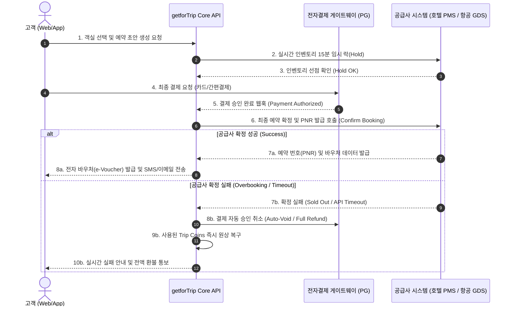

# getforTrip 실시간 공급사 연동 규격 및 실패 복구 명세서

**문서 번호**: GFT-AUDIT-004  
**작성 일시**: 2026-10-17  
**대상 도메인**: 7대 여행 도메인 공급사(GDS/PMS/CRS) 연동 엔진 및 트랜잭션 복구  
**감사관**: Go Backend Architect & Integration Engineer  

---

## 1. 공급사 연동 아키텍처 개요

getforTrip은 TripScanr(메타검색)와 달리 고객이 당사 플랫폼에서 직접 결제하고 최종 예약 확정 바우처를 발권받는 Online Travel Agency(OTA)입니다. 따라서 글로벌 공급사와의 실시간 2-Phase Commit 트랜잭션 정합성 유지가 핵심입니다.

---

## 2. 2단계 커밋(2-Phase Commit) 예약 프로세스 명세

### Phase 1: 예약 초안(Draft) 및 15분 인벤토리 락
- **API 엔드포인트**: `POST /api/v1/bookings`
- **목적**: 결제 진행 중 다른 사용자가 동일 객실을 가로채지 못하도록 15분간 인벤토리를 임시 홀드.
- **파라미터 규격**:
  - `user_id`: 인증 회원 UUID
  - `domain_type`: `HOTEL` | `FLIGHT` | `TRAIN` | `CAR` | `TRANSFER` | `ACTIVITY` | `PACKAGE`
  - `base_amount_krw`: 공급사 기준 요금
  - `trip_coins_used`: 사용 코인 (1G = ₩1)
  - `final_amount_krw`: 최종 결제 대상 금액
  - `traveler_details`: 여권 성명, 생년월일, 연락처

### Phase 2: 결제 승인 및 공급사 최종 PNR 확정
- **API 엔드포인트**: `POST /api/v1/bookings/:id/pay`
- **동작**:
  1. 결제 승인 확인
  2. 공급사 확정 API 호출: `POST /supplier/v1/confirm`
  3. 성공 시: 공급사 PNR(예: `HYATT-SEL-882194`) 저장 후 바우처 활성화
  4. 상태 전이: `DRAFT` -> `CONFIRMED`

---

## 3. 공급사 장애 및 잔여 객실 마감(Sold Out) 실패 복구 규격

### 3.1 실패 시나리오 및 보상 트랜잭션 (Compensating Transaction)
공급사 측에서 실시간 객실 마감, 가격 변동, 또는 네트워크 타임아웃(3초 초과)이 발생한 경우:
1. **결제 자동 승인 취소 (Auto Void)**: 결제된 전액(100%)을 위약금 0원으로 즉시 취소 처리.
2. **리워드 코인 롤백 (Coin Restitution)**: 결제 시 차감되었던 getfortrip 코인을 유저 계정에 즉시 반환.
3. **고객 투명 통보**: "공급사 시스템 객실 마감으로 인해 예약이 체결되지 않았으며, 결제 금액은 즉시 전액 환불되었습니다" 안내 모달 표출.
4. **고아 예약 방지**: 데이터베이스 상태를 `FAILED_REFUNDED`로 마킹하여 미완료 결제 잔존 방지.

### 3.2 타임아웃 및 서킷 브레이커 정책
- 공급사 단일 API 호출 타임아웃: **1,500ms**
- 재시도 정책: 최대 1회 (Idempotency Key 필수 부여)
- 장애 격리: 특정 공급사 API 장애 시 전체 서비스 마비 방지를 위한 Fallback 인벤토리 전환.

