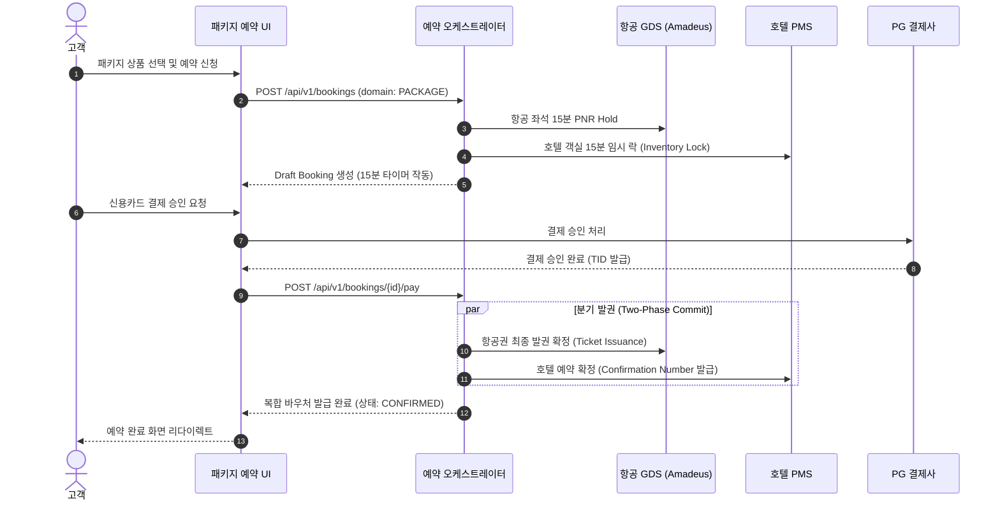

# getforTrip OTA — Package Booking Flow Analysis

## 1. 개요 및 P0-04 결함 원인 분석
항공+호텔 결합 패키지(Packages / Dynamic Packaging)는 개별 구매 대비 15%~25%의 가격 할인 혜택을 제공하며 OTA 플랫폼의 객단가(AOV)를 극대화하는 핵심 상품입니다.

### 기존 결함 원인 (Root Cause)
- `/packages/list/` 및 상세 페이지가 실질적인 번들 데이터 없이 비어 있는 Empty Shell 상태로 방치되어 있었음.
- 항공편과 호텔 객실을 결합하여 단일 결제로 예약하는 복합 오케스트레이션 로직이 구현되지 않음.

---

## 2. 해결 및 패키지 번들 엔진 설계

### 2.1 마스터 패키지 카탈로그 구축 (`packageCatalog.ts`)
주요 여행지별 특화 패키지 번들을 표준화하여 등록:
1. `pkg_tokyo_4d3n`: 도쿄 4박 5일 대한항공 왕복 + 그랜드 하얏트 도쿄 (20% 번들 할인)
2. `pkg_osaka_3d2n`: 오사카 3박 4일 아시아나 왕복 + 난바 오리엔탈 호텔 (18% 번들 할인)
3. `pkg_bangkok_5d4n`: 방콕 5박 6일 타이항공 왕복 + 만다린 오리엔탈 방콕 (22% 번들 할인)
4. `pkg_paris_7d5n`: 파리 7박 8일 에어프랑스 왕복 + 리츠 파리 럭셔리 (15% 번들 할인)

### 2.2 패키지 복합 예약 및 결제 오케스트레이션 플로우

### 2.3 공급사 단측 실패 시 롤백 (Compensating Transaction) 정책
- 만약 항공권 발권은 성공했으나 호텔 PMS 예약이 실시간 만실로 실패한 경우:
  1. 즉시 보상 트랜잭션(Compensating Transaction)을 가동하여 기 발권된 항공권을 취소 수수료 없이 Void(무효) 처리.
  2. 고객 결제 승인 건을 PG사에 전액 즉시 자동 취소/환불.
  3. 고객에게 "공급사 실시간 만실에 따른 즉시 자동 환불 완료" 알림 발송.
