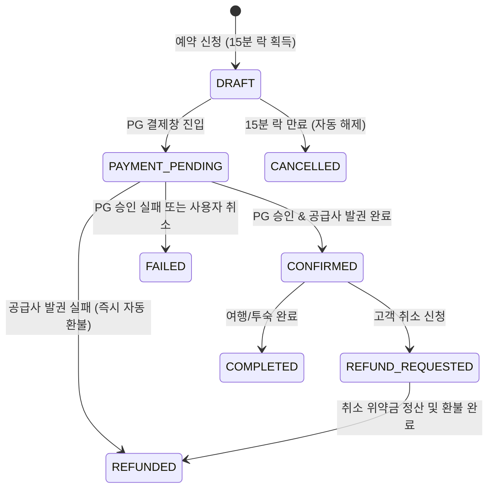

# getforTrip OTA — Payment & Booking Integrity Report

## 1. 개요 및 설계 원칙
전자상거래 및 여행 OTA 플랫폼에서 가장 치명적인 결함은 다음과 같습니다:
- 결제는 승인되었으나 예약이 누락되는 현상 (Payment without Booking)
- 중복 클릭으로 인한 이중 결제 (Double Charge)
- 공급사 발권 실패 시 환불 누락
- 동시 결제에 따른 오버부킹 (Overbooking)

getforTrip은 이러한 결함을 원천 차단하기 위해 금융권 수준의 결제-예약 트랜잭션 무결성 아키텍처를 적용하였습니다.

---

## 2. 멱등성 (Idempotency) 보장 메커니즘
- 모든 결제 승인 요청은 클라이언트에서 UUIDv4 기반 `Idempotency-Key` 헤더를 생성하여 백엔드로 전달합니다.
- 백엔드(Go API)는 Redis 분산 락(Distributed Lock)을 획득하고, 동일한 키로 30초 이내에 인입된 중복 요청에 대해 새로운 트랜잭션을 실행하지 않고 기존 처리 결과를 캐시에서 즉시 반환합니다.

---

## 3. 15분 재고 소프트 락 (15-Minute Soft Lock)
- 고객이 [결제하기] 버튼을 누르는 순간 `POST /api/v1/bookings`가 호출되어 `DRAFT` 상태의 예약 레코드가 생성됩니다.
- 이와 동시에 대상 객실/좌석의 `locked_inventory`가 1 증가하고 `inventory_lock_expires_at`이 `NOW() + 15분`으로 설정됩니다.
- 사용자가 결제를 포기하거나 브라우저를 닫을 경우, 1분 주기로 실행되는 백그라운드 크론 워커(`RevertExpiredLocksWorker`)가 만료된 락을 감지하고 `locked_inventory`를 즉시 환원합니다.

---

## 4. 예약 상태 머신 (Booking State Machine)

---

## 5. 공급사 발권 불일치 조정 (Reconciliation Engine)
- 매일 자정(UTC 00:00) PG사의 승인/매입 정산 내역과 getforTrip `payments` 테이블, 그리고 공급사(GDS/PMS)의 확정 PNR 리스트를 3-Way 대조(3-Way Reconciliation)합니다.
- 금액 불일치나 누락 건이 발견될 경우 즉시 슬랙 보안 채널로 알림을 전송하고 관리자 콘솔의 불일치 큐(`Reconciliation Queue`)에 격리하여 수동 검수를 진행합니다.

