# getforTrip OTA — Master Relational Database ERD

## 1. 개요
getforTrip 글로벌 Online Travel Agency (OTA) 시스템의 표준 관계형 데이터베이스(PostgreSQL 16+ / Cloud SQL / Cloudflare D1) 통합 엔터티-관계 다이어그램(ERD) 명세서이다.

본 설계는 글로벌 상용 엔터프라이즈급 멀티 도메인(호텔, 항공, 기차, 렌터카, 패키지, 투어&티켓, 공항픽업)을 단일 통합 예약/결제 오케스트레이션 엔진 하에서 원자적(ACID)으로 처리할 수 있도록 정규화(3NF) 및 파티셔닝 전략을 반영하였다.

---

## 2. Mermaid ERD 다이어그램

```mermaid
erDiagram
    USERS ||--o{ BOOKINGS : places
    USERS ||--o{ USER_COIN_LEDGER : earns_spends
    USERS ||--o{ REVIEWS : writes
    
    PARTNERS ||--o{ HOTELS : manages
    PARTNERS ||--o{ CAR_RENTALS : operates
    PARTNERS ||--o{ ACTIVITIES : provides
    PARTNERS ||--o{ TRANSFERS : operates
    PARTNERS ||--o{ PARTNER_API_KEYS : issues

    HOTELS ||--o{ HOTEL_ROOMS : contains
    HOTEL_ROOMS ||--o{ ROOM_INVENTORIES : tracks
    HOTEL_ROOMS ||--o{ ROOM_RATES : priced_at

    AIRLINES ||--o{ FLIGHT_SCHEDULES : operates
    AIRPORTS ||--o{ FLIGHT_SCHEDULES : origin_dest
    FLIGHT_SCHEDULES ||--o{ FLIGHT_FARES : offers

    TRAIN_OPERATORS ||--o{ TRAIN_SCHEDULES : runs
    TRAIN_SCHEDULES ||--o{ TRAIN_FARES : offers

    PACKAGES ||--|{ HOTELS : bundles
    PACKAGES ||--|{ FLIGHT_SCHEDULES : bundles

    BOOKINGS ||--|{ BOOKING_ITEMS : contains
    BOOKINGS ||--|| PAYMENTS : settles
    BOOKINGS ||--o{ REFUND_REQUESTS : initiates
    BOOKINGS ||--o{ BOOKING_TRAVELERS : registers

    COUPONS ||--o{ BOOKING_COUPON_REDEMPTIONS : redeemed_in
    BOOKINGS ||--o{ BOOKING_COUPON_REDEMPTIONS : applies

    USERS {
        uuid id PK
        varchar email UK
        varchar password_hash
        varchar full_name
        varchar phone
        varchar membership_tier
        int trip_coins_balance
        varchar status
        timestamptz created_at
        timestamptz updated_at
    }

    PARTNERS {
        uuid id PK
        varchar company_name
        varchar business_reg_number UK
        varchar contact_name
        varchar contact_email
        varchar contact_phone
        varchar commission_rate
        varchar settlement_bank_code
        varchar settlement_account_num
        varchar status
        timestamptz created_at
    }

    HOTELS {
        uuid id PK
        uuid partner_id FK
        varchar name_ko
        varchar name_en
        varchar country_code
        varchar city_code
        text address
        decimal latitude
        decimal longitude
        int star_rating
        decimal review_score
        varchar checkin_time
        varchar checkout_time
        jsonb amenities
        jsonb images
        varchar status
        timestamptz created_at
    }

    HOTEL_ROOMS {
        uuid id PK
        uuid hotel_id FK
        varchar name_ko
        varchar room_type
        int standard_occupancy
        int max_occupancy
        decimal room_size_sqm
        varchar bed_type
        jsonb room_amenities
        boolean has_breakfast
        boolean is_refundable
        timestamptz created_at
    }

    ROOM_INVENTORIES {
        uuid id PK
        uuid room_id FK
        date stay_date
        int total_allotted
        int locked_inventory
        int sold_inventory
        int available_inventory
        timestamptz updated_at
    }

    ROOM_RATES {
        uuid id PK
        uuid room_id FK
        date stay_date
        decimal base_price_krw
        varchar currency
        decimal supply_cost_krw
        timestamptz updated_at
    }

    FLIGHT_SCHEDULES {
        uuid id PK
        varchar airline_code
        varchar flight_number
        varchar origin_airport_code
        varchar destination_airport_code
        timestamptz departure_time
        timestamptz arrival_time
        varchar aircraft_type
        int duration_minutes
        varchar status
    }

    FLIGHT_FARES {
        uuid id PK
        uuid schedule_id FK
        varchar cabin_class
        varchar fare_basis_code
        int seat_available
        decimal base_price_krw
        decimal fuel_surcharge_krw
        decimal airport_tax_krw
        int free_baggage_kg
        boolean is_changeable
        boolean is_refundable
    }

    BOOKINGS {
        uuid id PK
        varchar booking_code UK
        uuid user_id FK
        varchar domain_type
        varchar status
        decimal base_amount_krw
        decimal tax_amount_krw
        decimal service_fee_krw
        decimal discount_amount_krw
        int trip_coins_used
        decimal final_amount_krw
        varchar paid_currency
        decimal paid_currency_amount
        varchar primary_contact_name
        varchar primary_contact_email
        varchar primary_contact_phone
        timestamptz inventory_lock_expires_at
        timestamptz created_at
        timestamptz confirmed_at
        timestamptz cancelled_at
    }

    BOOKING_ITEMS {
        uuid id PK
        uuid booking_id FK
        varchar item_type
        uuid target_resource_id
        varchar confirmation_pin
        jsonb snapshot_data
        decimal item_price_krw
        timestamptz checkin_or_departure
        timestamptz checkout_or_arrival
        varchar supplier_status
    }

    PAYMENTS {
        uuid id PK
        uuid booking_id FK
        varchar transaction_code UK
        varchar pg_provider
        varchar payment_method
        varchar pg_tid
        decimal amount
        varchar currency
        varchar status
        jsonb pg_raw_response
        timestamptz paid_at
        timestamptz cancelled_at
    }

    REFUND_REQUESTS {
        uuid id PK
        uuid booking_id FK
        decimal refund_amount_krw
        decimal penalty_fee_krw
        varchar refund_reason
        varchar status
        timestamptz requested_at
        timestamptz processed_at
    }

    USER_COIN_LEDGER {
        uuid id PK
        uuid user_id FK
        uuid booking_id FK
        varchar transaction_type
        int amount
        int balance_after
        varchar description
        timestamptz created_at
    }
```

---

## 3. 핵심 아키텍처 원칙

1. **단일 중앙 예약 오케스트레이션 (`BOOKINGS` & `BOOKING_ITEMS`)**
   - 호텔, 항공, 기차, 렌터카, 패키지 등 어떤 상품이든 `BOOKINGS` 루트 레코드를 공유하며, 세부 품목은 `BOOKING_ITEMS`에 다형성(Polymorphic) 키와 JSON 스냅샷(`snapshot_data`)으로 보존됩니다.
   - 이를 통해 패키지(항공+호텔 결합) 예약 시 1건의 결제로 항공 발권과 호텔 PMS 예약을 단일 트랜잭션으로 제어합니다.

2. **15분 소프트 락(Soft Lock) 메커니즘**
   - `inventory_lock_expires_at` 컬럼을 통해 고객이 결제창에 진입한 시점부터 15분간 재고(객실, 좌석)를 임시 확보하고, 미결제 만료 시 자동 해제(Revert)하여 오버부킹(Overbooking)을 방지합니다.

3. **다중 통화(Multi-Currency) 스냅샷 결제 모델**
   - 시스템 기준 화폐는 `KRW`를 기준으로 하되, 사용자가 선택한 결제 통화(`paid_currency`, `paid_currency_amount`) 및 결제 당시 환율을 `PAYMENTS` 테이블에 고정 기록하여 외환 변동에 따른 회계 오차를 제거합니다.

4. **파트너사(B2B) 격리 및 감사 추적**
   - 모든 공급사 리소스(`HOTELS`, `CAR_RENTALS`, `ACTIVITIES`)는 `partner_id`를 소유하며, RLS(Row Level Security) 또는 애플리케이션 레벨 권한 검증을 통해 타 공급사의 재고 및 정산 데이터에 접근할 수 없도록 강제합니다.

