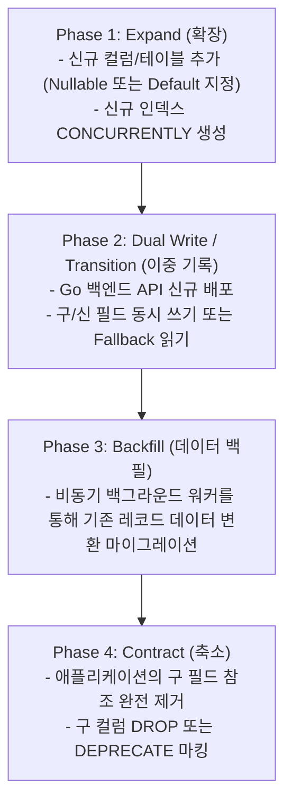

# getforTrip OTA — Database Migration Plan

## 1. 개요 및 마이그레이션 철학
글로벌 24/365 트래픽을 처리하는 getforTrip OTA의 데이터베이스 마이그레이션은 **무중단 배포 (Zero-Downtime Migration)**를 절대 원칙으로 삼습니다. 

이를 위해 **Expand and Contract (확장 및 축소)** 패턴을 표준으로 적용하며, 모든 DDL은 이전 버전의 애플리케이션과 호환성을 유지한 상태에서 단계별로 적용됩니다.

---

## 2. 마이그레이션 단계별 로드맵 (Expand & Contract)



---

## 3. 세부 실행 절차 및 안전 규칙

### 3.1 DDL 락 방지 규칙 (PostgreSQL / Cloud SQL)
1. **`ALTER TABLE ADD COLUMN` 시 주의사항**
   - PostgreSQL 11 이상에서는 기본값(`DEFAULT`)이 상수인 경우 테이블 전체 재작성(Full Table Rewrite) 없이 메타데이터만 갱신되므로 즉시 안전하게 추가 가능합니다.
   - 단, `NOT NULL` 제약조건을 기본값 없이 직접 추가하는 행위는 절대 금지합니다. 먼저 Nullable로 추가한 후 백필 완료 시점에 `NOT NULL` 제약조건을 추가합니다.

2. **인덱스 생성 시 `CREATE INDEX CONCURRENTLY` 강제**
   - 대용량 트랜잭션 테이블(`bookings`, `payments`, `room_inventories`)에 인덱스를 생성할 때 테이블 쓰기 락(Exclusive Lock)을 유발하는 일반 인덱스 생성은 엄격히 금지됩니다.
   - 반드시 `CREATE INDEX CONCURRENTLY` 구문을 사용하여 라이브 서비스 중 트랜잭션 차단 없이 백그라운드에서 빌드합니다.

3. **락 타임아웃 (`lock_timeout`) 필수 설정**
   - 모든 마이그레이션 세션은 시작 전 `SET lock_timeout = '3s';`를 실행하여, 3초 이상 락 획득 대기가 발생할 경우 즉시 실패하도록 설정하여 전체 서비스 커넥션 풀 고갈을 방지합니다.

---

## 4. 버전 관리 및 마이그레이션 도구 표준

- **도구**: `golang-migrate/migrate` 또는 Flyway
- **디렉토리 구조**:
  ```text
  backend/migrations/
  ├── 000001_init_schema.up.sql
  ├── 000001_init_schema.down.sql
  ├── 000002_add_room_soft_lock.up.sql
  ├── 000002_add_room_soft_lock.down.sql
  └── ...
  ```
- **CI/CD 파이프라인**:
  - GitHub Actions 파이프라인에서 스테이징 DB를 복제한 임시 인스턴스에 `migrate up` 및 `migrate down`을 사전 실행하여 롤백 스크립트의 무결성을 100% 검증한 후 프로덕션에 적용합니다.

---

## 5. 롤백(Rollback) 및 비상 복구 대책

1. **마이그레이션 실패 시**
   - 트랜잭션 DDL을 지원하는 PostgreSQL 특성을 활용하여 실패 시 즉시 자동 롤백됩니다.
2. **배포 후 애플리케이션 에러 감지 시**
   - Phase 1, Phase 2 단계에서는 신규 컬럼이 추가되었더라도 구버전 코드가 정상 작동하므로 즉시 Go API 버전을 이전 릴리스로 롤백합니다.
   - DB 컬럼의 물리적 삭제(`down.sql`)는 서비스 안정화 확인 후 최소 24시간 이후 별도 작업으로 진행합니다.
